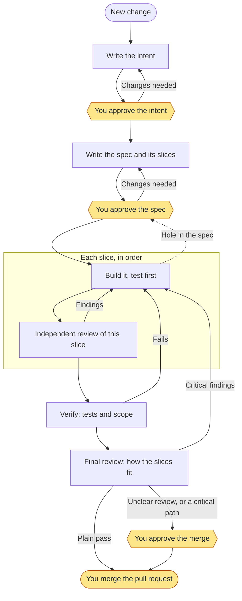
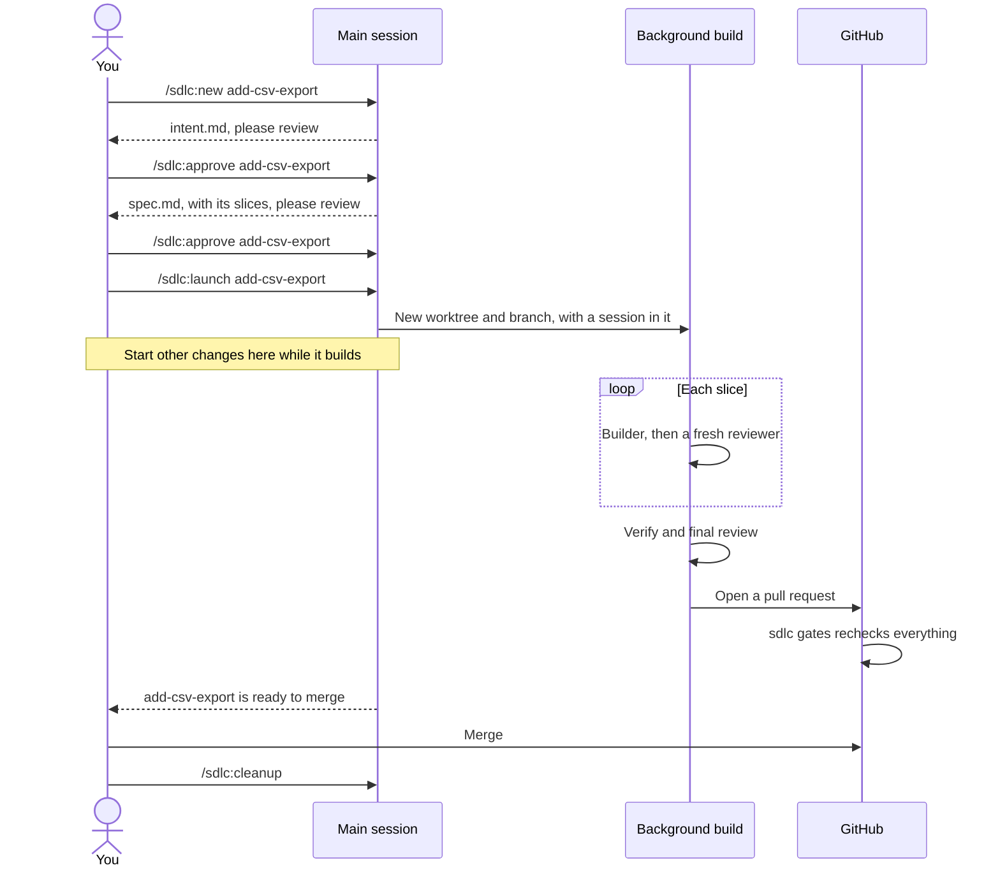
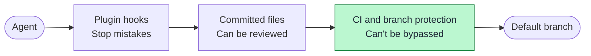

# ai-sdlc

A software factory for Claude Code. `sdlc` is a plugin that takes each change from an idea to a merged pull request through agents, tests, and review, and stops only when it needs you.

- **Git holds everything.** Specs, plans, approvals, and evidence are committed files, so work survives a closed session and leaves an audit trail.
- **Code decides what happens next, not the model.** The `sdlc` CLI runs a state machine, and agents can't skip a step by claiming it's done.
- **You stay in charge.** Only a person can approve a gate, and only a person merges.

> **Status: early.** It has shipped four real changes on one project. See [What's proven](#whats-proven) before you rely on it.

## How it works

Every change takes the same path, from a typo to a new feature. What changes is how long the documents are, not the steps.



The yellow steps are yours. Everything else runs by itself.

- **Intent** says what's wrong and what would be better. You can stop a weak idea here, before anyone spends time on a spec.
- **The spec** says exactly what will change, broken into slices. You approve the slices and the files each one may touch, so you know the scope before any code exists.
- **A slice** is a small step that can be reviewed on its own. An independent reviewer that saw none of the building checks each one, so a mistake is caught before the next slice builds on it.

Two approvals is the normal case. If a path you've marked as critical is touched, the merge and release also need your sign-off.

You stay in one main session on your default branch. You talk through each change there, and each build runs in the background in its own worktree. Inside a build, a lead session hands each role to its own agent, and each role can only do its own job: the reviewer can't edit, and the verifier can only write tests.



## Tutorial: your first change

This walks through adding a CSV export to a project. You need Claude Code, Node 20 or later, and a Git repo.

### 1. Install the plugin

From your repo:

```bash
claude plugin marketplace add shortlst-ai/ai-sdlc
claude plugin install sdlc@ai-sdlc --scope project
```

`--scope project` turns the plugin on for this repo only.

### 2. Set up the factory

Run `claude`, then:

```text
/sdlc:init
```

It finds your setup, test, and format commands, and asks which paths are critical or protected. Then commit what it created, because worktrees can't see it until you do:

```bash
git add .sdlc .claude/settings.json .gitignore
git commit -m "Adopt the software factory"
```

### 3. Turn on the CI gate

The local checks stop mistakes. This one stops everything else, because it runs where an agent can't reach it.

```bash
mkdir -p .github/workflows
curl -o .github/workflows/sdlc-gates.yml \
  https://raw.githubusercontent.com/shortlst-ai/ai-sdlc/main/plugins/sdlc/templates/sdlc-gates.yml
```

Then, in your repo's branch protection settings, make `gates` a required check on your default branch.

### 4. Start the change

Start Claude on your default branch, in a terminal with `claude` or in the VS Code panel. This is your main session, and you can keep it for all your work. Then:

```text
/sdlc:new add-csv-export

Let people export the orders table as CSV.
```

The session writes `intent.md`: the problem, the outcome you want, and any open questions. Until you launch it, the change is a draft: its files sit uncommitted in `.sdlc/`, and your default branch doesn't move.

### 5. Approve the intent

The session stops and shows you the intent. If it's the wrong idea, stop here, because nothing else has been spent yet. Otherwise:

```text
/sdlc:approve add-csv-export
```

Typing `/sdlc:approve` alone lists what's waiting, and `/sdlc:approve all` approves all of it.

### 6. Approve the spec

Agents research the code and write `spec.md`, including the slices:

````markdown
### S1: Add the export query

```scope
src/orders/query.py
```

### S2: Add the download button

```scope
src/orders/views.py
```
````

Each `scope` block lists what that slice may touch. Anything outside it gets refused later, so check these. If you'd change something, say so, and the session updates the spec. Then approve it the same way.

The spec opens with a short "What you're approving" section, and that's what the session shows you. On most changes you can decide from that alone, and the rest is there if you want it. Research the agents did goes in `notes.md`, which you don't approve. If a document runs long, `/sdlc:status` warns you, with its word count.

An approval is tied to the exact text you approved. If the spec changes afterward, the gate reopens, and the session shows you only what changed.

### 7. Launch the build

```text
/sdlc:launch add-csv-export
```

This creates a worktree and a branch, moves the change into them, commits it, and starts a background session there. Your main session is free straight away, so you can start another change.

Background sessions only run in a folder you've trusted. If launch says the workspace isn't trusted, run `claude` once in your project, accept the prompt, and launch again. Your change is kept.

### 8. Let it run

The build builds its own environment. For each slice, a builder writes it test-first, and a fresh reviewer checks that slice alone. The next slice doesn't start until it passes. Then your tests run, and a final review checks how the slices fit together.

If a step fails, it goes back and fixes it, up to a limit. If it hits that limit, it stops. If something turns up mid-build:

- **New work** that this change doesn't need becomes an issue, so the change stays small.
- **A hole in the spec** means the build amends the spec and stops, which reopens that gate for you.

You don't need to watch it. While your main session is open and idle, it wakes up when a build needs you and says so: an approval is waiting, it stopped with work left, it's stuck on a permission prompt, or it's ready to merge. To check at any time:

```text
/sdlc:status
```

Approve in your main session as usual, and the build that was waiting starts again by itself. To restart one that stopped, run `/sdlc:launch` again.

### 9. Merge and clean up

When the review passes, the build opens a pull request. Read it, check that `gates` is green, and merge it yourself. If your repo has no remote, it gives you a `git merge` command instead.

Then remove the worktree and branch:

```text
/sdlc:cleanup
```

It only touches changes that have merged, and it won't delete uncommitted work. A squashed merge can't be told apart from an unmerged branch, so use a merge commit, or delete that branch yourself.

### A smaller change

A typo fix takes the same steps, and each one is short: a line of intent, a few lines of spec, and one slice. There's no shortcut, because small changes are where assumptions go unchecked. For a bug fix, the spec says which test should fail first.

## Running changes in parallel

Nothing extra is needed. Start another draft in your main session at any time, and launch each one when its spec is approved. Name the change in your commands when several are open.

The first change to merge moves your default branch, so the others need to catch up:

```text
/sdlc:sync add-csv-export
```

Each build also syncs itself before it opens its pull request. What happens depends on what changed:

| What main brought in | What happens |
| --- | --- |
| Nothing that touches this change's files | The change is updated, and if it was already tested, your tests run again on the combined code |
| Those tests fail | It goes back to build |
| Changes to the same files | It goes back to build, then through verify and final review again |
| A conflict | It goes back to build, and the build resolves the conflict first |

Going back this way doesn't count against the rework limit, because the change did nothing wrong. Slice reviews still stand. A build that's running is left alone.

Don't merge or rebase by hand, because `sync` also keeps the change's records straight. If you already have, run `/sdlc:sync` to repair them.

Specs that share no files can run side by side with no trouble, and the `scope` blocks show you that before you launch. Two changes to the same files will work, but the second pays for another round of verify and review.

Some limits to know about:

- **You hear about builds while the main session is open and idle.** If you closed it, `/sdlc:status` shows where each one got to.
- **Background sessions need a trusted folder.** If `/sdlc:launch` says the workspace isn't trusted, run `claude` once in that project, accept the prompt, and launch again. Your work is kept.
- **Builds use your default permission mode.** A build that stops on a permission prompt shows as blocked, and `claude attach` opens it.
- **`/sdlc:cleanup` can't recognize a squash merge,** because the branch's commits never reach main. Remove that worktree yourself. The same goes for an abandoned change.

## Commands

| Command | What it does |
| --- | --- |
| `/sdlc:init` | Sets up the factory in a repo |
| `/sdlc:new <name>` | Starts a change |
| `/sdlc:next [name]` | Runs the next step |
| `/sdlc:launch <name>` | Builds an approved change in its own worktree, or restarts one that stopped |
| `/sdlc:status` | Shows every change, what it needs, and whether its build is running |
| `/sdlc:approve [name]` | Records your approval. People only |
| `/sdlc:sync [name]` | Brings your default branch into a change |
| `/sdlc:cleanup [name]` | Removes the worktrees and branches of merged changes |
| `/sdlc:abandon [id] <reason>` | Closes a change, keeping it on record. People only |
| `/sdlc:learn` | Turns mistakes that repeat across changes into suggested rules |
| `/sdlc:diagnose <id>` | Adds a likely cause to a CI breach |

The model can't run `approve` or `abandon`. They work only when a person types them.

## Watching CI

`sdlc-monitor.yml` checks CI on your default branch each day. If a workflow fails too often, it opens a pull request with a work item, so nobody has to notice first. Nothing gets built until you approve that item.

Copy it from `plugins/sdlc/templates/` as you did in step 3. Your CI has to run on pushes to the default branch, and you have to allow GitHub Actions to create pull requests. Detection is plain code and needs no API key. With an `ANTHROPIC_API_KEY` secret, a read-only agent also adds a likely cause.

The limits are in `.sdlc/config.json`.

## What protects your code



The first two layers keep an honest agent on track, but they run on your machine, so a determined one could get around them. **The CI check is the real boundary**, so turn it on.

## What's proven

This is new software, so here's what has and hasn't been tested.

**Tested on real work**

- Three real changes went through an earlier version on one project, with no rework
- One real change went through this one-path process, with two approvals and no rework
- Forged approvals and a gutted gate were both blocked on GitHub
- `/sdlc:approve` works from the terminal and the VS Code panel
- Installing from GitHub works
- Two builds ran side by side in the background on a throwaway repo. The second hit real conflicts with the first, synced, and resolved them unattended

**Not proven yet**

- **Parallel builds haven't run on real work.** The main session's parts were run as scripts, so nobody has yet typed `/sdlc:launch` in a live session or the VS Code panel, or been woken there by a finished build. Only auto mode has been tried
- **Shorter specs are only tested on a typo.** An eval writes one that opens with what you're approving, in about 120 words, with no diagram or background. A real change of any size hasn't been through it, and the length limits are a first guess
- **`sync` hasn't met a real remote.** Pushing and pull request updates are tested against a local bare repo
- **Test-first is an instruction, not a lock.** Agents are told to write the failing test first, and nothing enforces it
- **Verify evidence covers committed code.** Commit before `sdlc verify`, because uncommitted new files aren't counted
- **The deploy stage isn't built.** It's parked until there's a project to deploy, and a way to separate the agent from the approver
- **The CI monitor hasn't run on a live repo.** Its commands are tested, but the workflow itself hasn't run
- **Some attacks are only tested locally.** Deleting `.sdlc/` is refused on a fresh clone, but hasn't been tried on GitHub, and neither has a pull request that edits `sdlc-gates.yml`
- **A pull request that only changes `.sdlc/config.json` passes the gate,** so review that file whenever it changes
- **Forged approvals can pass on a solo repo.** An approval with the right hash and a made-up name passes `sdlc gates`, so on a team, pull request review is the real sign-off
- **The diagnoser isn't fully resistant to instructions planted in CI logs.** It ignored them in 12 of 14 test runs. In the other two it ran `sdlc advance`, which the gate would refuse, and the cause is unexplained

Agent teams are experimental in Claude Code and need a terminal session. In the VS Code panel, the same roles run as plain subagents, and so do builds started by `/sdlc:launch`.

## Develop

```bash
npm run check   # tests and plugin validation
npm run evals   # real model calls, about $1
```

- Design: [docs/proposal.md](docs/proposal.md)
- Notes from the first real runs: [docs/phase-1-notes.md](docs/phase-1-notes.md)
- Roadmap: [milestones](../../milestones)

## License

[MIT](LICENSE)
