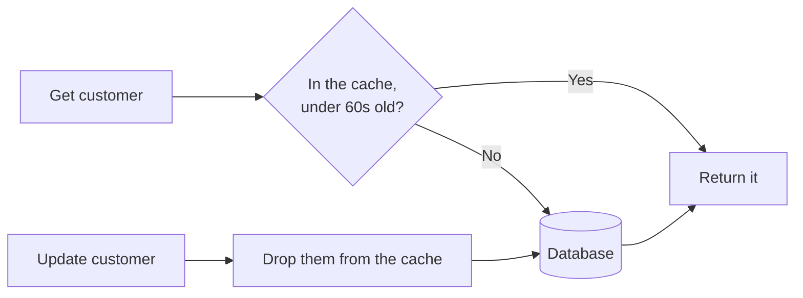

<p align="center"></p>

# Agentic-SDLC: a software factory that takes each change from idea to merged pull request

[](https://github.com/shortlst-ai/agentic-sdlc/actions/workflows/ci.yml)
[](LICENSE)

`sdlc` is a Claude Code plugin. You describe a change and approve two short documents. Agents build it a slice at a time, test it, and review it, then you merge the pull request.

> **Early software.** It has shipped four real changes on one project. Read [what's proven](docs/whats-proven.md) before you rely on it.

## The problems it solves

| Coding with AI often means | With `sdlc` |
| --- | --- |
| Specs too long to read, so you skim and approve | Each spec opens with what you're approving in a few lines, with a diagram where it helps. Length is checked in code |
| The agent says it's done when it isn't | Code decides each step, not the model. Tests have to pass, and the evidence is recorded |
| Changes that sprawl past what you asked for | Each slice may touch only the files you approved, and anything outside them is refused |
| Reviewing every line yourself | An independent reviewer checks each slice before the next one builds on it |
| Losing the thread when a session ends | Specs, approvals, and evidence are committed to Git, so any session can pick up |
| Waiting while one change finishes | Several changes build at once in the background, while you stay in one session |

You stay in charge throughout: only you can approve, and only you merge.

## Quick start

You need Claude Code, Node 20 or later, and a Git repo. From the repo:

```bash
claude plugin marketplace add shortlst-ai/agentic-sdlc
claude plugin install sdlc@agentic-sdlc --scope project
claude
```

Then, in Claude, run `/sdlc:init`. It finds your setup and test commands. Commit what it created:

```bash
git add .sdlc .claude/settings.json .gitignore
git commit -m "Adopt the software factory"
```

Then start your first change:

```text
/sdlc:new add-csv-export
```

Describe the change, and approve the intent and spec with `/sdlc:approve` when the session asks. `/sdlc:launch add-csv-export` starts the build, and you'll be told when the pull request is ready.

The [tutorial](docs/tutorial.md) walks through every step, including the CI check that makes the gates hold.

## How it works

Every change takes the same path, from a typo to a new feature. Only the length of the documents changes.


The yellow steps are yours, and everything else runs by itself.

- **The intent** says what's wrong and what would be better, so you can stop a weak idea before anyone writes a spec.
- **The spec** says exactly what will change, in slices, with the files each one may touch.
- **Each slice** is built test-first, then checked by a reviewer that saw none of the building.

You work from one session on your default branch. Each build runs in the background in its own worktree, so you can [run several at once](docs/parallel.md).

## Specs you can read

Ask an agent for a spec and you often get pages: background, definitions, how it checked things, and the change buried somewhere inside. Here, everything you approve is written for you:

- **The decision comes first.** Every spec opens with "What you're approving", in no more than 10 lines, and that's what the session shows you.
- **You approve only what binds the build.** The agents' research goes in `notes.md`, which you don't approve.
- **Diagrams show structure.** When a change affects how parts connect, a flow, or states, the spec draws it.
- **Length is checked, not just requested.** A long spec goes back to be cut before you see it.
- **A changed spec shows only what changed.** You see a diff, not the whole file again.

For a change that caches customer lookups, the top of the spec looks like this:

> **What you're approving**
>
> - **Change:** cache customer lookups in the service for 60 seconds
> - **Before → after:** repeat lookups skip the database, and an update shows straight away
> - **Slices:** S1 Add the cache (`shop/service.py`); S2 Drop a customer on update (`shop/service.py`)
> - **Out of scope:** caching anything other than customers
> - **Needs you:** is 60 seconds stale enough to accept?



On a real project, an 80-line fix used to come with a 2,200-word spec. In tests, a typo fix now gets about 120 words. This hasn't been through a real change yet.

## Commands

| Command | What it does |
| --- | --- |
| `/sdlc:init` | Sets up the factory in a repo |
| `/sdlc:new <name>` | Starts a change |
| `/sdlc:approve [name]` | Records your approval. People only |
| `/sdlc:launch <name>` | Builds an approved change in its own worktree, or restarts one that stopped |
| `/sdlc:status` | Shows every change, what it needs, and whether its build is running |
| `/sdlc:next [name]` | Runs the next step |
| `/sdlc:sync [name]` | Brings your default branch into a change |
| `/sdlc:cleanup [name]` | Removes the worktrees and branches of merged changes |
| `/sdlc:abandon [id] <reason>` | Closes a change, keeping it on record. People only |
| `/sdlc:learn` | Turns mistakes that repeat across changes into suggested rules |
| `/sdlc:diagnose <id>` | Adds a likely cause to a CI breach |

The model can't run `approve` or `abandon`. They work only when a person types them.

## Who it's for

**A good fit** if you use Claude Code on a Git repo, alone or in a small team, and want agents to do the work without giving up review. It's strongest on GitHub, where a required CI check enforces the gates.

**Not a fit yet** if you need it to deploy, since it stops at a merged pull request. Nor if your project has no command that runs its tests, because verifying a change depends on one.

## Questions

**How long does a change take?** You're needed only at the two approvals and the merge, and the rest runs by itself. On a real project, an 80-line fix took about 43 minutes of agent time. About half of the build went on running the same 80-second test suite 13 times. Now the full suite runs once per change, a small fix defaults to one slice, and builds run on Sonnet. That should roughly halve a change like it, but it hasn't been measured on a real change yet. A slow test suite costs the most, so a parallel test runner helps too.

**What does it cost?** It runs on your Claude Code plan or API usage. Most roles use Sonnet, and research uses Haiku. There aren't per-change cost figures yet.

**Terminal or VS Code?** Both. Approvals work in either.

**Do I need GitHub?** No. Without a remote, the build gives you a `git merge` command to run. But the CI check is the only gate an agent can't get around, and it needs GitHub. See [what protects your code](docs/ci.md).

**Can the agent approve its own work?** No. `/sdlc:approve` only works when a person types it, and CI rechecks every approval against the exact text that was approved.

**Which languages?** Any. `/sdlc:init` reads your repo to find its setup and test commands. So far it has only been used on Python.

**How do I stop a change?** `/sdlc:abandon <id> <reason>` closes it and keeps it on record.

## Limits

- **Proven on one real project so far.** Running builds in parallel and the shorter specs have only been tested on test repos.
- **It can stop on permission prompts.** Builds use your default permission mode, and only auto mode has been tried.
- **Test-first is an instruction, not a lock.** Agents are told to write the failing test first, and nothing enforces it.
- **On a solo repo, pull request review is the real sign-off.** A forged approval with a made-up name can pass the gate.

The full list is in [what's proven](docs/whats-proven.md).

## What it runs and changes

The plugin sends nothing anywhere itself. It edits `.claude/settings.json` to allow its own `sdlc` command and turn on agent teams, commits each change's records to that change's branch, and creates worktrees under `.claude/worktrees/`. It runs your project's setup and test commands, `git`, background `claude` sessions, and, with a GitHub remote, `gh` to open pull requests and issues. The [plugin's README](plugins/sdlc/README.md#what-it-runs-and-changes) lists everything.

## Learn more

- [Tutorial: your first change](docs/tutorial.md)
- [Running changes in parallel](docs/parallel.md)
- [What protects your code, and the CI monitor](docs/ci.md)
- [What's proven](docs/whats-proven.md)
- [Design](docs/proposal.md) and [notes from the first real runs](docs/phase-1-notes.md)
- [Contributing](CONTRIBUTING.md)

## License

[MIT](LICENSE)
