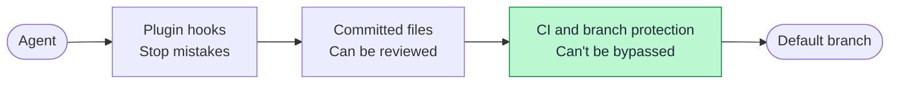

# What protects your code

The first two layers keep an honest agent on track, but they run on your machine, so a determined one could get around them. **The CI check is the real boundary**, so turn it on.

To turn on the CI check, follow [step 3 of the tutorial](tutorial.md#3-turn-on-the-ci-gate).

## Watching CI

`sdlc-monitor.yml` checks CI on your default branch each day. If a workflow fails too often, it opens a pull request with a work item, so nobody has to notice first. Nothing gets built until you approve that item.

Copy it from `plugins/sdlc/templates/`, as in [step 3 of the tutorial](tutorial.md#3-turn-on-the-ci-gate). Your CI has to run on pushes to the default branch, and you have to allow GitHub Actions to create pull requests. Detection is plain code and needs no API key. With an `ANTHROPIC_API_KEY` secret, a read-only agent also adds a likely cause.

The limits are in `.sdlc/config.json`.
