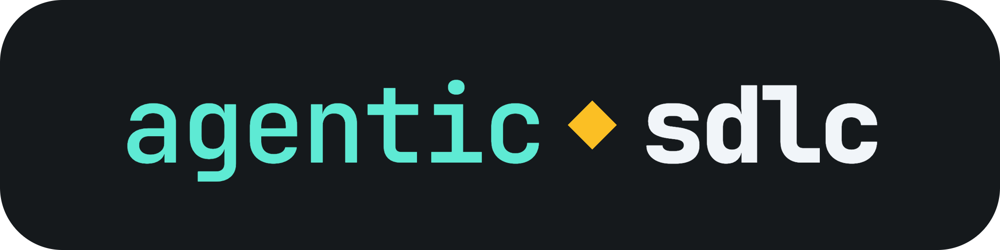

# sdlc

A software factory for Claude Code. You describe a change and approve two short documents: what's wrong, and exactly what will change. Agents then build it a slice at a time, test it, and review it, and you merge the pull request. Specs, approvals, and evidence are committed to Git, and code decides each step rather than the model. Only a person can approve, and nothing merges without one.

Full guide, tutorial, and limits: [github.com/shortlst-ai/agentic-sdlc](https://github.com/shortlst-ai/agentic-sdlc).

## Quick start

```bash
claude plugin marketplace add shortlst-ai/agentic-sdlc
claude plugin install sdlc@agentic-sdlc --scope project
```

In Claude, run `/sdlc:init`, commit what it created, then `/sdlc:new <name>`.

It works in Claude Code only, because it ships a command-line tool, `sdlc`, and depends on Git and hooks.

## What it runs and changes

Everything happens on your machine, in your repository, unless a step below says otherwise. The plugin sends nothing anywhere itself.

**In your repository**

- `/sdlc:init` writes `.sdlc/config.json`, adds `.claude/worktrees/` to `.gitignore`, and edits `.claude/settings.json`. That edit allows `Bash(sdlc *)`, so agents can run the factory's own command without asking, sets `CLAUDE_CODE_EXPERIMENTAL_AGENT_TEAMS=1`, and sets `worktree.baseRef` to `head`, so a slice built in a worktree of its own starts from the change's branch. The `sdlc` command can't approve or abandon anything, and `sdlc merge` merges only a change a person signed off, which is why allowing it is safe
- Each change gets a folder under `.sdlc/work/`. `sdlc` commits that folder as a change moves through its steps, on the change's own branch and never on your default branch
- `/sdlc:new`, on your default branch, creates a Git worktree under `.claude/worktrees/` and a branch for the change. Slices built at the same time get worktrees there too, which `sdlc merge-slice` merges back and removes
- `/sdlc:sync` merges your default branch into a change, and pushes the branch if it already has an upstream
- `/sdlc:cleanup` removes the worktree and branch of a change that has merged

**Commands it runs**

- Your project's own setup, test, quick check, and format commands, which you agree to in `/sdlc:init`
- `git`, for branches, worktrees, commits, merges, and pushes
- VS Code's `code --new-window`, to open a window on a new change's worktree, when the session runs inside VS Code
- `gh`, when your repo has a GitHub remote: to open a pull request for a finished change, and an issue for work found along the way. It uses your existing `gh` login

**Hooks**

Hooks check edits and shell commands against the change's approved scope, refuse ones that would skip a step, format files you edit, and record approvals only when a person types `/sdlc:approve`. They run locally and send nothing anywhere.

**Optional CI templates**

`templates/sdlc-gates.yml` and `templates/sdlc-monitor.yml` are workflows you can copy into your repo. Each downloads this plugin's code from GitHub when it runs. The monitor reads your CI history with `gh`, opens a pull request when CI fails too often, and, if you add an `ANTHROPIC_API_KEY` secret, runs a read-only agent to suggest a cause.

## License

MIT
